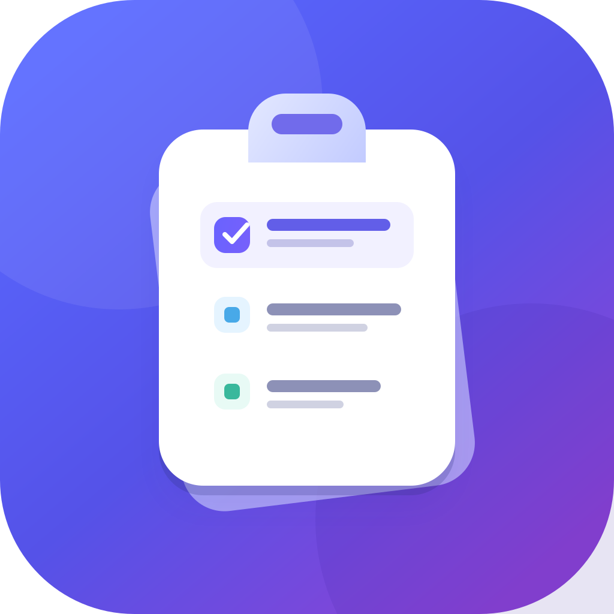

# ClipShelf

Clipboard history for macOS. The app lives in the menu bar and opens with **⌘⇧V**.



## Features

- Stores the latest 80 text and image clipboard entries locally.
- Search history, then select an item to copy it back and auto-paste into the app you were using.
- Pause monitoring and clear the history at any time.
- Optional start-at-login setting managed by macOS Login Items.
- Skips clipboard changes made while common password-manager apps are frontmost.
- Does not sync clipboard contents to a server.

History is stored locally as a JSON file without additional app-level encryption.
macOS may ask for permission to read clipboard contents and to send the paste keystroke. If auto-paste permission is declined, the selected item is still copied; press **⌘V** yourself.

## Build

Requires Xcode and XcodeGen.

The ready-to-open app is `dist/ClipShelf-1.3.app`; a zipped copy is `dist/ClipShelf-1.3-macOS.zip`.

```sh
xcodegen generate
xcodebuild -project ClipShelf.xcodeproj -scheme ClipShelf -configuration Release -derivedDataPath build build
```

The app bundle is created under `build/Build/Products/Release/ClipShelf.app`.

